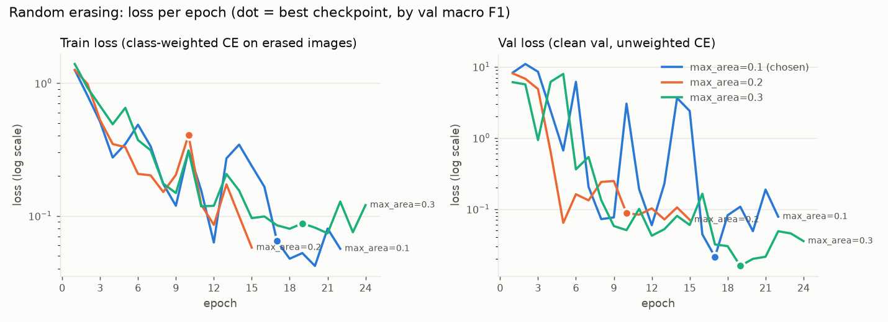
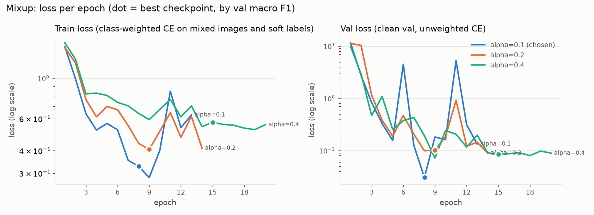
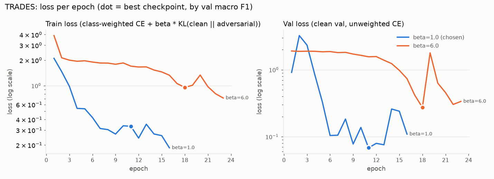

# Augmentation-based defences: training and validation loss

Generated by `modules/augmentation-based/report.py` from the per-epoch histories in this folder.

- **Train loss** is each defence's own training objective averaged over the epoch. It includes the
  defence (erased / mixed / adversarial inputs, TRADES' KL term), so it is only comparable
  between settings of the same defence, not across defences.
- **Val loss** is plain cross entropy on clean `val/` images (no class weights, no defence),
  so it is comparable across all runs.
- **Best epoch** is the checkpoint kept (highest clean-val macro F1, as in Phase 1).
  `min_val_loss` shows whether the lowest-loss epoch differs from it.

## Random erasing

| setting | epochs_trained | best_epoch | train_loss_at_best | val_loss_at_best | min_val_loss | min_val_loss_epoch | val_accuracy | val_macro_f1 | chosen |
|---|---|---|---|---|---|---|---|---|---|
| max_area=0.1 | 22 | 17 | 0.0645 | 0.0213 | 0.0213 | 17 | 0.9961 | 0.998 | yes |
| max_area=0.2 | 15 | 10 | 0.4058 | 0.0875 | 0.064 | 5 | 0.9883 | 0.9755 |  |
| max_area=0.3 | 24 | 19 | 0.0877 | 0.0159 | 0.0159 | 19 | 0.9961 | 0.9912 |  |

## Mixup

| setting | epochs_trained | best_epoch | train_loss_at_best | val_loss_at_best | min_val_loss | min_val_loss_epoch | val_accuracy | val_macro_f1 | chosen |
|---|---|---|---|---|---|---|---|---|---|
| alpha=0.1 | 13 | 8 | 0.3269 | 0.0303 | 0.0303 | 8 | 1.0 | 1.0 | yes |
| alpha=0.2 | 14 | 9 | 0.4052 | 0.1014 | 0.0897 | 14 | 0.9767 | 0.968 |  |
| alpha=0.4 | 20 | 15 | 0.5724 | 0.0849 | 0.0717 | 9 | 0.9922 | 0.9958 |  |

## TRADES

| setting | epochs_trained | best_epoch | train_loss_at_best | val_loss_at_best | min_val_loss | min_val_loss_epoch | val_accuracy | val_macro_f1 | chosen |
|---|---|---|---|---|---|---|---|---|---|
| beta=1.0 | 16 | 11 | 0.3322 | 0.0683 | 0.0683 | 11 | 0.9883 | 0.9854 | yes |
| beta=6.0 | 23 | 18 | 0.9555 | 0.2738 | 0.2738 | 18 | 0.9805 | 0.9745 |  |
